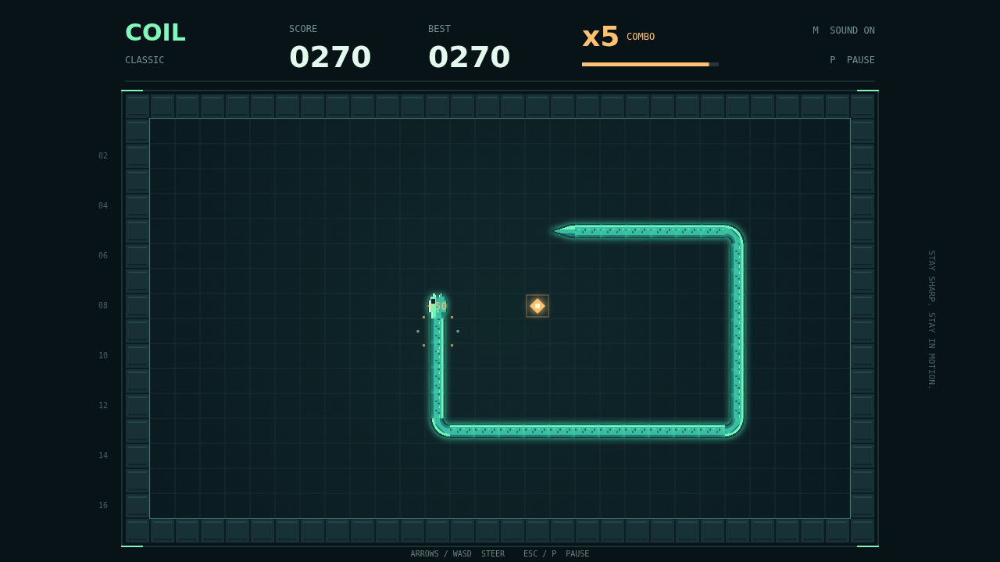

# Find your line.

**Coil** is a neon grid serpent about making the next move count. Guide a luminous mint-green snake through a dark, enclosed grid, chasing amber pellets and leaving one continuous trail behind you.

Every pellet makes you longer. Every turn takes commitment. You can turn at right angles, but you can never double back; touch a wall or your own body and the run ends. Look beyond the next pellet and leave yourself a way out.

Speed of thought earns the bigger score. Eat again while the combo window is open and your multiplier climbs, up to **x5**. Hesitate too long and it drops back to one. The best route keeps both your snake and your streak alive.

Steer with the arrow keys or WASD, or use the touch pad. Pause whenever you need a breath, then return to the same tight corner. Chase your session best—or fill every last cell for a perfect circuit.

